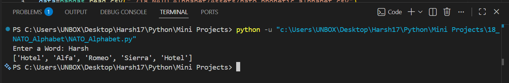

# 🪖 NATO Phonetic Alphabet Converter

A simple Python application that converts any English word into its **NATO Phonetic Alphabet** representation. The program reads the NATO alphabet from a CSV file using **Pandas** and uses a dictionary comprehension to translate each letter into its corresponding phonetic code word.

     

---

# 📸 Screenshot

### Program Output


---

# ✨ Features

- 🔤 Converts words into the NATO Phonetic Alphabet
- 📄 Reads alphabet data directly from a CSV file
- 📚 Uses Dictionary Comprehension for efficient lookup
- ⚠️ Handles invalid input using exception handling
- 🔁 Allows users to retry after entering invalid characters
- 🐼 Uses the Pandas library for CSV processing
- 💻 Beginner-friendly and easy-to-understand code

---

# 📂 Project Structure

```text
18_NATO_Alphabet/
│
├── Assets/
│   └── nato_phonetic_alphabet.csv
│
├── Screenshot/
│   └── 1.png
│
├── NATO_Alphabet.py
└── README.md
```

---

# 🛠️ Technologies Used

- Python 3
- Pandas
- CSV Files

---

# 🚀 How to Run

### Clone the repository

```bash
git clone https://github.com/Harsh-Belekar/Python-Projects.git
```

### Navigate to the project

```bash
cd Python-Projects/18_NATO_Alphabet
```

### Install dependencies

```bash
pip install pandas
```

### Run the program

```bash
python NATO_Alphabet.py
```

---

# 🎮 How to Use

1. Run the program.
2. Enter any English word.
3. The program converts each letter into its NATO phonetic equivalent.
4. If numbers or special characters are entered, the program displays an error message and asks for input again.

---

# ⚙️ How It Works

- Loads the NATO alphabet data from a CSV file.
- Creates a dictionary using dictionary comprehension.
- Accepts a word from the user.
- Converts each character into its NATO phonetic code.
- Uses exception handling to detect invalid characters.
- Prints the converted NATO alphabet list.

---

# 📂 Source Files

## `NATO_Alphabet.py`

Main application file.

Responsibilities:

- Read the CSV file using Pandas
- Create the NATO dictionary
- Accept user input
- Convert letters into NATO code words
- Handle invalid input using `try-except`

---

# 📁 Assets

## `nato_phonetic_alphabet.csv`

Contains all NATO phonetic alphabet mappings.

Example:

```csv
letter,code
A,Alfa
B,Bravo
C,Charlie
D,Delta
...
X,X-ray
Y,Yankee
Z,Zulu
```

---

# 📚 Concepts Practiced

- Dictionary Comprehension
- Pandas
- CSV File Handling
- Lists
- List Comprehension
- Functions
- Exception Handling
- Recursion
- User Input
- Python Dictionaries

---

# 🎓 Learning Outcomes

Through this project, I learned:

- Reading CSV files using Pandas
- Creating dictionaries with dictionary comprehension
- Using list comprehensions for data transformation
- Handling invalid user input with exceptions
- Working with external datasets
- Writing clean and reusable Python functions
- Building simple command-line utilities

---

# 📂 More Projects

This project is part of my **Python Projects Portfolio**, a collection of Python projects covering:

- 🎮 Games
- 🎨 Graphics Programming
- 🖥️ GUI Applications
- 🤖 Automation
- 🌐 API Integrations
- 📊 Data Processing
- 🧩 Python Fundamentals

*Explore the repository to discover more projects and follow my Python learning journey.*

***⭐ If you like this project, don't forget to star the repository!***
