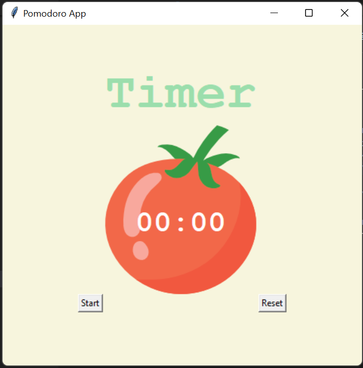
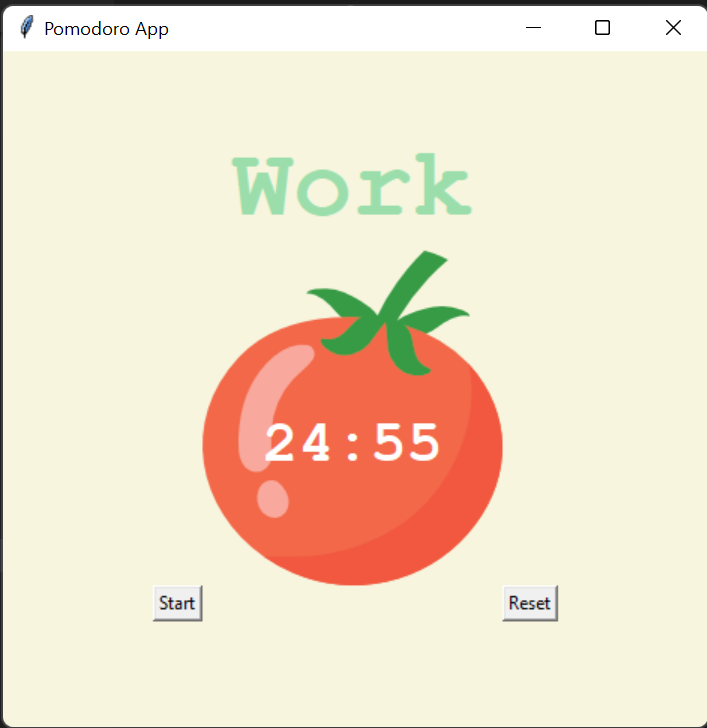

# 🍅 Pomodoro Timer

A simple and visually appealing **Pomodoro Timer** built with **Python Tkinter**. The application follows the **Pomodoro Technique**, alternating between focused work sessions and short/long breaks to improve productivity. It features an attractive tomato-themed interface, countdown timer, session tracking, and reset functionality.

     

---

# 📸 Screenshots

### Home Screen


### Work Session Started


---

# ✨ Features

- 🍅 Beautiful tomato-themed user interface
- ⏱️ 25-minute work timer
- ☕ 5-minute short break timer
- 🌴 20-minute long break timer
- 🔄 Automatic switching between work and break sessions
- ✔️ Displays completed work session checkmarks
- ▶️ Start timer with a single click
- 🔁 Reset timer anytime
- 🎨 Clean and beginner-friendly Tkinter GUI

---

# 📂 Project Structure

```text
19_Pomodoro_Timer/
│
├── Assets/
│   └── tomato.png
│
├── Screenshot/
│   ├── 1.png
│   └── 2.png
│
├── Pomodoro.py
└── README.md
```

---

# 🛠️ Technologies Used

- Python 3
- Tkinter
- Math Module

---

# 🚀 How to Run

### Clone the repository

```bash
git clone https://github.com/Harsh-Belekar/Python-Projects.git
```

### Navigate to the project

```bash
cd Python-Projects/19_Pomodoro_Timer
```

### Run the application

```bash
python Pomodoro.py
```

---

# 🎮 How to Use

1. Launch the application.
2. Click the **Start** button to begin a work session.
3. The timer automatically counts down from **25 minutes**.
4. After each work session, a break starts automatically.
5. A **short break** follows every work session.
6. After four work sessions, a **long break** begins automatically.
7. Completed work sessions are displayed as ✔ checkmarks.
8. Click **Reset** to stop the timer and return to the initial state.

---

# ⚙️ How It Works

- Uses Tkinter to create the graphical user interface.
- Tracks completed sessions using a repetition counter.
- Automatically determines whether the next session is:
  - Work
  - Short Break
  - Long Break
- Updates the countdown every second using `after()`.
- Displays progress using checkmarks after each completed work session.
- Allows the timer to be reset at any time.

---

# 📂 Source Files

## `Pomodoro.py`

Main application file.

Responsibilities:

- Create the Tkinter GUI
- Manage Pomodoro session logic
- Handle countdown timer
- Automatically switch between work and break sessions
- Display completed session checkmarks
- Reset the timer
- Load and display the tomato image

---

# 📁 Assets

## `tomato.png`

Tomato image displayed at the center of the application as the main visual element.

---

# 📚 Concepts Practiced

- Tkinter GUI Development
- Event-Driven Programming
- Canvas Widget
- Labels
- Buttons
- Timer Scheduling using `after()`
- Functions
- Global Variables
- Countdown Logic
- Mathematical Calculations
- GUI Layout using Grid

---

# 🎓 Learning Outcomes

Through this project, I learned:

- Designing desktop GUI applications with Tkinter
- Creating countdown timers using `after()`
- Managing application state with global variables
- Building responsive event-driven interfaces
- Working with Canvas, Labels, Buttons, and Images
- Automating work and break session scheduling
- Organizing Python code for maintainable GUI applications

---

# 📂 More Projects

This project is part of my **Python Projects Portfolio**, a collection of Python projects covering:

- 🎮 Games
- 🎨 Graphics Programming
- 🖥️ GUI Applications
- 🤖 Automation
- 🌐 API Integrations
- 📊 Data Processing
- 🧩 Python Fundamentals

*Explore the repository to discover more projects and follow my Python learning journey.*

***⭐ If you like this project, don't forget to star the repository!***