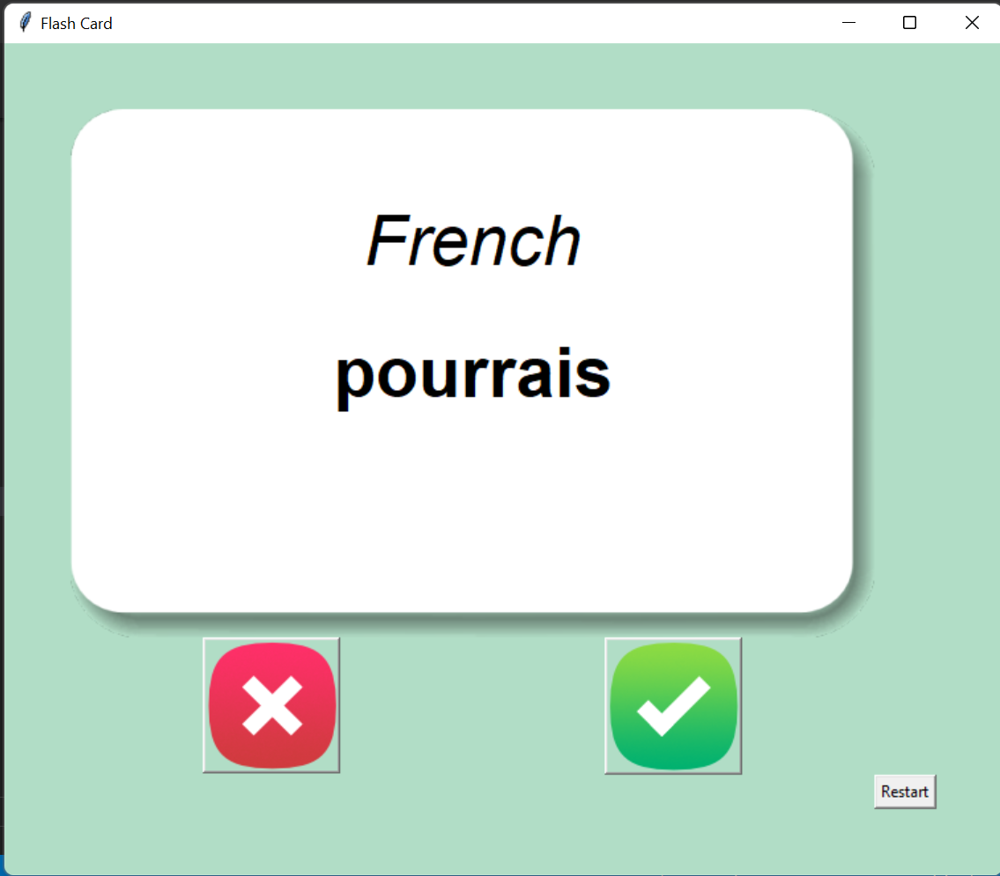
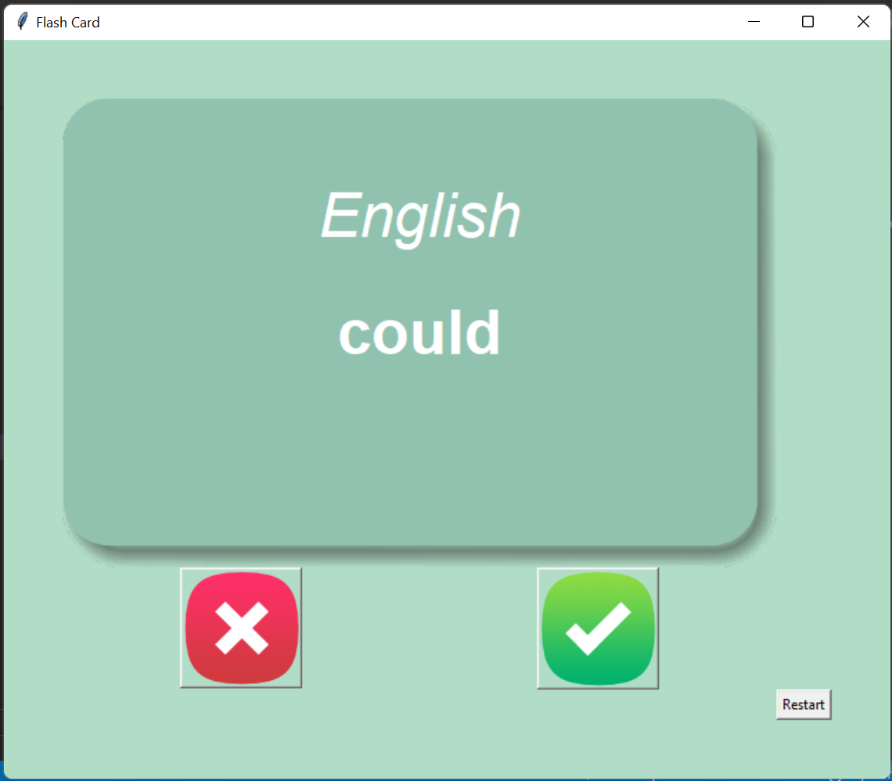

# 🃏 Flash Card App

A desktop-based **Flash Card Application** built using **Python**, **Tkinter**, and **Pandas** to help users learn **French vocabulary**. The app displays a French word, automatically flips the card after a few seconds to reveal its English translation, and keeps track of learned words by saving progress in a CSV file.

      

---

# 📸 Screenshots

### Flash Card Home


### Word Translation


---

# ✨ Features

- 🃏 Interactive flash card interface
- 🇫🇷 Learn French vocabulary
- 🇬🇧 Automatically reveals English translation
- ⏱️ Auto-flips cards after 3 seconds
- ✅ Mark words as learned
- ❌ Skip unknown words
- 💾 Automatically saves learning progress
- 🔄 Restart learning progress anytime
- 📂 CSV-based vocabulary storage
- 🖥️ Simple and user-friendly Tkinter GUI

---

# 📂 Project Structure

```text
20_Flash_Card_App/
│
├── Assets/
│   ├── data.csv
│   ├── word_to_learn.csv
│   ├── card_front.png
│   ├── card_back.png
│   ├── right.png
│   └── wrong.png
│
├── Screenshot/
│   ├── 1.png
│   └── 2.png
│
├── Flash_Card.py
└── README.md
```

---

# 🛠️ Technologies Used

- Python 3
- Tkinter
- Pandas
- CSV Files
- Random Module

---

# 🚀 How to Run

### Clone the repository

```bash
git clone https://github.com/Harsh-Belekar/Python-Projects.git
```

### Navigate to the project

```bash
cd Python-Projects/20_Flash_Card_App
```

### Install dependencies

```bash
pip install pandas
```

### Run the application

```bash
python Flash_Card.py
```

---

# 🎮 How to Use

1. Launch the application.
2. A random **French word** is displayed on the flash card.
3. Wait **3 seconds** for the card to flip automatically.
4. Read the **English translation**.
5. Click:
   - ✅ **Right Button** if you know the word (removes it from future sessions).
   - ❌ **Wrong Button** to skip and continue learning.
6. Click **Restart** to reset all learning progress.

---

# ⚙️ How It Works

- Loads French-English vocabulary from a CSV file.
- Randomly selects a French word.
- Automatically flips the flash card after 3 seconds.
- Displays the English translation.
- Removes learned words from the learning list.
- Saves remaining words to `word_to_learn.csv`.
- Allows users to restart and reload the complete vocabulary list.

---

# 📂 Source Files

## `Flash_Card.py`

Main application file.

Responsibilities:

- Create the Tkinter GUI
- Load vocabulary from CSV files
- Display random flash cards
- Automatically flip cards after a timer
- Save learning progress
- Handle user interactions
- Restart learning progress

---

# 📁 Assets

## `data.csv`

Contains the complete French-English vocabulary dataset.

## `word_to_learn.csv`

Stores the remaining words that the user has not yet learned.

## `card_front.png`

Front side of the flash card displaying the French word.

## `card_back.png`

Back side of the flash card displaying the English translation.

## `right.png`

Button image used to mark a word as learned.

## `wrong.png`

Button image used to skip a word.

---

# 📚 Concepts Practiced

- Tkinter GUI Development
- Canvas Widget
- Buttons & Images
- Event Handling
- Timers using `after()`
- CSV File Handling
- Pandas DataFrames
- Random Module
- Exception Handling
- File Persistence
- Functions
- Dictionaries
- User Progress Tracking

---

# 🎓 Learning Outcomes

Through this project, I learned:

- Building desktop GUI applications with Tkinter
- Working with CSV datasets using Pandas
- Implementing timed events using `after()`
- Managing user learning progress
- Reading and writing CSV files
- Creating interactive educational applications
- Handling exceptions gracefully
- Designing reusable GUI components

---

# 📂 More Projects

This project is part of my **Python Projects Portfolio**, a collection of Python projects covering:

- 🎮 Games
- 🎨 Graphics Programming
- 🖥️ GUI Applications
- 🤖 Automation
- 🌐 API Integrations
- 📊 Data Processing
- 🧩 Python Fundamentals

*Explore the repository to discover more projects and follow my Python learning journey.*

***⭐ If you like this project, don't forget to star the repository!***