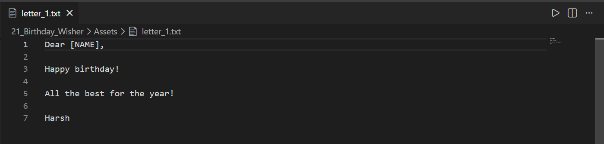
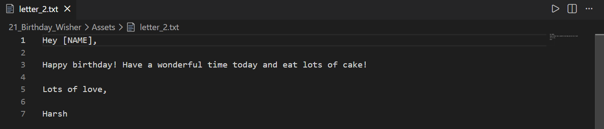
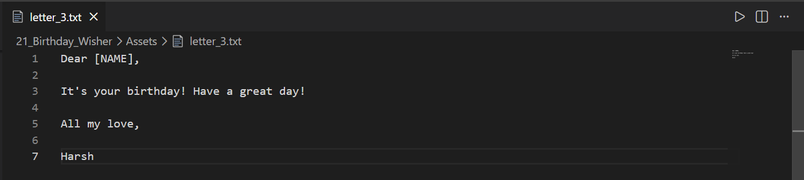

# 🎂 Birthday Wisher

An automated **Birthday Wisher** built with **Python** that checks today's date, matches birthdays stored in a CSV file, randomly selects a birthday letter template, personalizes it with the recipient's name, and automatically sends a birthday email using Gmail SMTP.

      

---

## 📸 Screenshots

### Sample Birthday Letter 1


### Sample Birthday Letter 2


### Sample Birthday Letter 3


---

## ✨ Features

- 🎂 Automatically checks today's date
- 📅 Reads birthdays from a CSV file
- 🎉 Detects if today is someone's birthday
- 📝 Randomly selects one of three birthday letter templates
- 👤 Replaces the placeholder with the recipient's name
- 📧 Sends personalized birthday emails automatically
- 🔒 Uses Gmail SMTP with TLS encryption
- 📂 Simple CSV-based data management
- ⚡ Fully automated workflow

---

## 📂 Project Structure

```
21_Birthday_Wisher/
│
├── Assets/
│   ├── birthdays.csv
│   ├── letter_1.txt
│   ├── letter_2.txt
│   └── letter_3.txt
│
├── Screenshot/
│   ├── 1.png
│   ├── 2.png
│   └── 3.png
│
├── Birthday_Wisher.py
└── README.md
```

---

## 🛠️ Technologies Used

- Python
- Pandas
- SMTP (smtplib)
- Datetime
- Random
- CSV File Handling

---

## 🚀 How to Run

### 1. Clone the repository

```bash
git clone https://github.com/Harsh-Belekar/Python-Projects.git
```

### 2. Navigate to the project

```bash
cd 21_Birthday_Wisher
```

### 3. Install Pandas

```bash
pip install pandas
```

### 4. Configure your Gmail account

Inside `Birthday_Wisher.py`:

```python
my_email="your_email@gmail.com"
my_password="your_app_password"
```

> **Note:** Use a Gmail **App Password** instead of your account password.

### 5. Run the program

```bash
python Birthday_Wisher.py
```

---

## ⚙️ How It Works

1. Reads today's date.
2. Loads birthday records from `birthdays.csv`.
3. Checks if anyone has a birthday today.
4. Randomly selects one of the letter templates.
5. Replaces the `[NAME]` placeholder.
6. Connects to Gmail SMTP.
7. Sends the personalized birthday email automatically.

---

## 📂 Source File

### Birthday_Wisher.py

Responsible for:

- Reading birthday data
- Checking today's date
- Selecting random letter templates
- Personalizing birthday messages
- Sending emails using Gmail SMTP

---

## 📁 Assets

### birthdays.csv

Stores birthday information including:

- Name
- Email Address
- Birth Year
- Month
- Day

### Letter Templates

- `letter_1.txt`
- `letter_2.txt`
- `letter_3.txt`

These files contain different birthday message templates with a placeholder:

```
[NAME]
```

which is automatically replaced with the recipient's name before sending.

---

## 📚 Concepts Practiced

- Object-free modular scripting
- CSV data processing
- Dictionary comprehensions
- Datetime module
- Random template selection
- File handling
- String replacement
- Email automation
- SMTP protocol
- TLS secure connection
- Python standard libraries

---

## 🎓 Learning Outcomes

Through this project, I learned:

- How SMTP email automation works
- Sending emails securely using Gmail SMTP
- Reading CSV files using Pandas
- Working with datetime in Python
- Random template selection
- Personalizing emails using placeholders
- File handling in Python
- Secure authentication with TLS
- Automating repetitive tasks

---

# 📂 More Projects

This project is part of my **Python Projects Portfolio**, a collection of Python projects covering:

- 🎮 Games
- 🎨 Graphics Programming
- 🖥️ GUI Applications
- 🤖 Automation
- 🌐 API Integrations
- 📊 Data Processing
- 🧩 Python Fundamentals

*Explore the repository to discover more projects and follow my Python learning journey.*

***⭐ If you like this project, don't forget to star the repository!***
