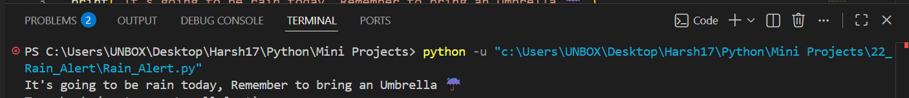

# 🌧️ Rain Alert

A Python automation project that checks the upcoming weather forecast using the **OpenWeatherMap API** and automatically sends an SMS reminder via **Twilio** if rain is expected within the next few hours.

This project demonstrates how to integrate multiple APIs to build a practical weather notification system.

     

---

## 📸 Screenshot

### Rain Alert Output



---

## ✨ Features

- 🌦️ Fetches real-time weather forecast data
- 🌧️ Detects rain based on weather condition codes
- 📱 Sends SMS alerts automatically
- ☔ Reminds users to carry an umbrella
- 🌍 Uses geographical coordinates for location-based forecasts
- 🔗 Integrates OpenWeatherMap REST API
- 📨 Uses Twilio API for SMS notifications
- ⚡ Fully automated weather monitoring

---

## 📂 Project Structure

```
22_Rain_Alert/
│
├── Screenshot/
│   └── screenshot1.png
│
├── Rain_Alert.py
└── README.md
```

---

## 🛠️ Technologies Used

- Python
- Requests
- OpenWeatherMap API
- Twilio API
- JSON
- REST API

---

## 🚀 How to Run

### 1. Clone the repository

```bash
git clone https://github.com/Harsh-Belekar/Python-Projects.git
```

### 2. Navigate to the project

```bash
cd 22_Rain_Alert
```

### 3. Install dependencies

```bash
pip install requests twilio
```

### 4. Configure your credentials

Inside `Rain_Alert.py`, replace:

```python
api_key="your_API_Key"

account_SID="your_account_SID"

auth_token="your_auth_token"
```

with your own credentials.

Also update the destination phone number:

```python
to="+91xxxxxxxxxx"
```

---

### 5. Run the project

```bash
python Rain_Alert.py
```

If rain is predicted within the forecast period, you'll receive an SMS notification.

---

## ⚙️ How It Works

1. Sends a request to the OpenWeatherMap Forecast API.
2. Retrieves the upcoming weather forecast in JSON format.
3. Checks the weather condition codes.
4. Detects whether rain is expected.
5. Connects to Twilio.
6. Sends an SMS reminder to carry an umbrella.

---

## 📂 Source File

### Rain_Alert.py

Responsible for:

- Connecting to the OpenWeatherMap API
- Fetching weather forecast data
- Parsing JSON responses
- Detecting rain using weather condition codes
- Connecting to Twilio
- Sending SMS notifications

---

## 🌦️ Weather Condition Logic

The application considers the following weather codes as rain:

```python
500 <= weather_id <= 600
```

If any forecast contains a weather condition within this range, an SMS alert is sent.

---

## 📱 SMS Notification

Example message:

```
It's going to be rain today,
Remember to bring an Umbrella ☔
```

---

## 📚 Concepts Practiced

- REST API integration
- HTTP GET requests
- Working with JSON data
- API authentication
- Weather forecasting APIs
- SMS automation
- Third-party Python libraries
- Conditional logic
- Secure credential management
- Automation scripting

---

## 🎓 Learning Outcomes

Through this project, I learned:

- How to consume REST APIs using Python
- Making HTTP requests with the Requests library
- Parsing JSON responses
- Understanding weather condition codes
- Working with OpenWeatherMap APIs
- Sending SMS using Twilio
- Integrating multiple APIs into one application
- Automating real-world notifications
- Managing API credentials securely

---

## 🔒 Security Note

This project uses API keys and authentication tokens.

For production projects, it's recommended to store sensitive credentials using **environment variables** or a `.env` file instead of hardcoding them in the source code.

---

# 📂 More Projects

This project is part of my **Python Projects Portfolio**, a collection of Python projects covering:

- 🎮 Games
- 🎨 Graphics Programming
- 🖥️ GUI Applications
- 🤖 Automation
- 🌐 API Integrations
- 📊 Data Processing
- 🧩 Python Fundamentals

*Explore the repository to discover more projects and follow my Python learning journey.*

***⭐ If you like this project, don't forget to star the repository!***