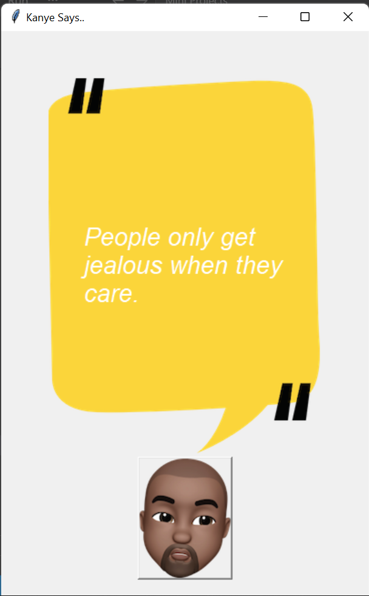
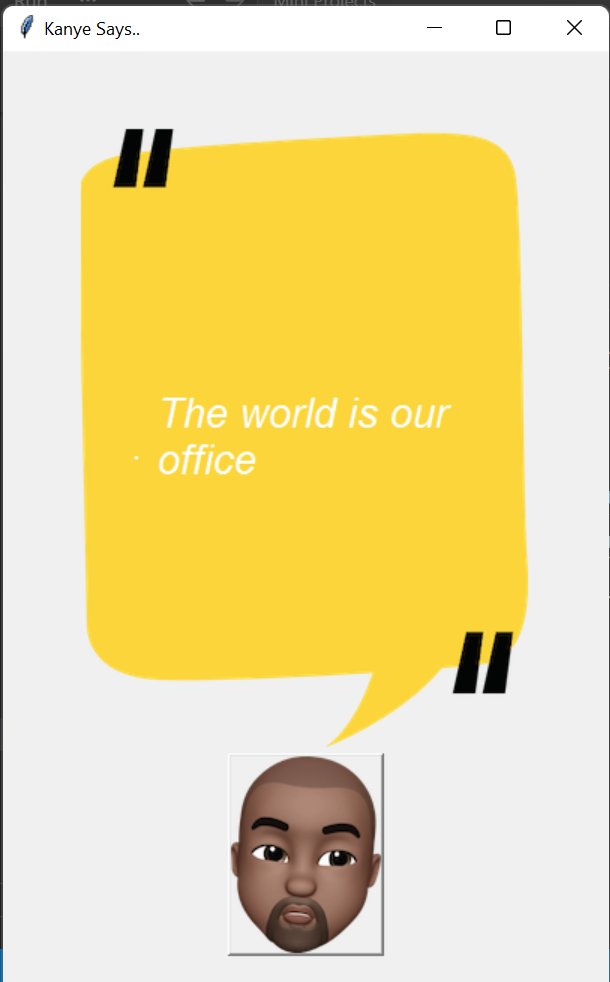

# 🎤 Kanye Quotes

A simple Python desktop application that displays random inspirational and iconic **Kanye West quotes** using the **Kanye REST API**. The application features an interactive Tkinter GUI where users can click on Kanye's image to instantly receive a new quote.

     

---

## ✨ Features

- 🎤 Fetches random Kanye West quotes
- 🌐 Uses the Kanye REST API
- 🖥️ Interactive Tkinter graphical interface
- 🖼️ Custom background and Kanye image
- 🔄 One-click quote refresh
- ⚡ Fast API response
- 🎨 Clean and minimal user interface

---

## 📂 Project Structure

```text
24_Kanye_Quotes/
│
├── Assets/
│   ├── background.png
│   └── kanye.png
│ 
├── Screenshot/
│   ├── 1.png
│   └── 2.png
│
├── Kanye_Quotes.py
│
└── README.md
```

---

## 🛠️ Technologies Used

- Python 3
- Tkinter
- Requests
- REST API

---

## 🚀 How to Run

### 1️⃣ Clone the Repository

```bash
git clone https://github.com/Harsh-Belekar/Python-Projects.git

# Navigate to the project
cd 24_Kanye_Quotes
```

### 2️⃣ Install Required Library

```bash
pip install requests
```

### 3️⃣ Run the Application

```bash
python Kanye_Quotes.py
```

---

## ⚙️ How It Works

1. Launches a Tkinter GUI window.
2. Displays a quote card with a background image.
3. Loads a custom Kanye West button.
4. When the user clicks the Kanye image:
   - Sends a request to the Kanye REST API.
   - Retrieves a random quote.
   - Updates the quote displayed on the card.
5. Users can continue clicking to receive unlimited random quotes.

---

## 📂 Source File

| File | Description |
|------|-------------|
| **Kanye_Quotes.py** | Creates the GUI, fetches random quotes from the API, and updates the displayed quote. |

---

## 🌐 API Used

### 🎤 Kanye REST API

Used to fetch random Kanye West quotes.

Features:

- Random quote generation
- JSON response
- Lightweight REST API
- No authentication required

---

## 📚 Concepts Practiced

- Tkinter GUI Development
- REST API Integration
- HTTP GET Requests
- JSON Parsing
- Event-Driven Programming
- Button Callbacks
- Canvas Widget
- Image Handling in Tkinter
- Dynamic Text Updates

---

## 📸 Screenshots

### Main Window


### Random Quote


---

## 🎓 Learning Outcomes

Through this project, I learned:

- Building desktop applications using Tkinter.
- Connecting Python applications to REST APIs.
- Sending HTTP GET requests with the Requests library.
- Parsing JSON data received from APIs.
- Updating GUI elements dynamically.
- Handling button click events.
- Working with images inside Tkinter applications.
- Creating simple interactive desktop utilities.

---

## 🔒 Note

This project depends on the public **Kanye REST API**. An active internet connection is required to fetch new quotes.

---

# 📂 More Projects

This project is part of my **Python Projects Portfolio**, a collection of Python projects covering:

- 🎮 Games
- 🎨 Graphics Programming
- 🖥️ GUI Applications
- 🤖 Automation
- 🌐 API Integrations
- 📊 Data Processing
- 🧩 Python Fundamentals

*Explore the repository to discover more projects and follow my Python learning journey.*

***⭐ If you like this project, don't forget to star the repository!***