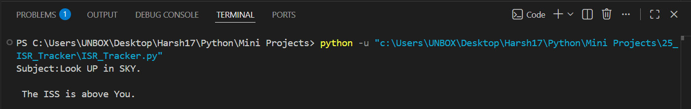

# 🛰️ ISS Tracker

A Python automation project that monitors the **International Space Station (ISS)** in real time and sends an **email notification** whenever the ISS is passing near your location during nighttime. The application combines multiple public APIs to determine the ISS position, sunrise/sunset times, and automatically alerts you when conditions are ideal for spotting the ISS in the sky.

     

---

## ✨ Features

- 🛰️ Tracks the International Space Station (ISS) in real time
- 📍 Checks whether the ISS is near your geographical location
- 🌙 Determines whether it is currently nighttime
- 📧 Sends an email notification when the ISS is visible
- ⏱️ Automatically checks every 60 seconds
- 🌐 Uses multiple public REST APIs
- ⚡ Fully automated monitoring system

---

## 📂 Project Structure

```text
25_ISR_Tracker/
│
├── ISR_Tracker.py
│
├── Screenshot/
│   └── 1.png
│
└── README.md
```

---

## 🛠️ Technologies Used

- Python 3
- Requests
- SMTP (smtplib)
- Datetime
- Time
- REST APIs

---

## 🚀 How to Run

### 1️⃣ Clone the Repository

```bash
git clone https://github.com/Harsh-Belekar/Python-Projects.git

# Navigate to the project
cd 25_ISR_Tracker
```

### 2️⃣ Install Required Library

```bash
pip install requests
```

### 3️⃣ Configure Your Credentials

Update the following values inside **ISR_Tracker.py**:

```python
my_email = "your_email@gmail.com"
my_password = "your_password"
```

Replace:

- Sender Email
- Receiver Email
- Email Password

Also update your location:

```python
my_lat = YOUR_LATITUDE
my_lng = YOUR_LONGITUDE
```

### 4️⃣ Run the Program

```bash
python ISR_Tracker.py
```

---

## ⚙️ How It Works

1. Retrieves the current ISS location using the Open Notify API.
2. Checks whether the ISS is within ±5° latitude and longitude of your location.
3. Retrieves sunrise and sunset times using the Sunrise-Sunset API.
4. Determines whether it is currently nighttime.
5. If both conditions are true:
   - ISS is nearby
   - It is nighttime
6. Sends an email notification reminding you to look up at the sky.
7. Repeats the process every 60 seconds.

---

## 📂 Source File

| File | Description |
|------|-------------|
| **ISR_Tracker.py** | Tracks the ISS location, checks night conditions, and sends email alerts automatically. |

---

## 🌐 APIs Used

### 🛰️ Open Notify API

Used to retrieve the current position of the International Space Station.

Features:

- Real-time ISS coordinates
- Latitude and longitude
- Public API
- No authentication required

---

### 🌅 Sunrise-Sunset API

Used to determine local sunrise and sunset times.

Features:

- Sunrise time
- Sunset time
- Timezone-independent response
- Public REST API

---

## 📚 Concepts Practiced

- REST API Integration
- HTTP Requests
- JSON Parsing
- Email Automation
- SMTP Protocol
- Infinite Loops
- Time Scheduling
- Datetime Module
- Conditional Logic
- Working with Geographic Coordinates

---

## 📸 Screenshot

### Email Notification



---

## 🎓 Learning Outcomes

Through this project, I learned:

- Working with multiple REST APIs in a single application.
- Fetching and processing real-time geographical data.
- Determining day and night using sunrise/sunset information.
- Automating email notifications with Python's SMTP library.
- Scheduling repetitive tasks using time intervals.
- Parsing JSON responses efficiently.
- Building practical automation projects using external APIs.

---

## 🔒 Security Note

This project contains placeholder values for:

- Email Address
- Email Password
- Receiver Email

Never commit your real credentials to GitHub. Store sensitive information securely using environment variables or a `.env` file.

---

# 📂 More Projects

This project is part of my **Python Projects Portfolio**, a collection of Python projects covering:

- 🎮 Games
- 🎨 Graphics Programming
- 🖥️ GUI Applications
- 🤖 Automation
- 🌐 API Integrations
- 📊 Data Processing
- 🧩 Python Fundamentals

*Explore the repository to discover more projects and follow my Python learning journey.*

***⭐ If you like this project, don't forget to star the repository!***